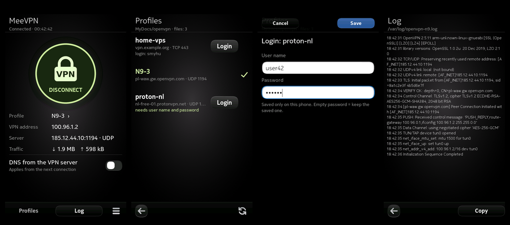

# MeeVPN – OpenVPN client app for the Nokia N9

MeeVPN connects your Nokia N9 (MeeGo Harmattan PR1.3) to an OpenVPN server with one tap.
It is the graphical front end for [openvpn-n9](https://github.com/smyhu/openvpn-n9) (OpenVPN 2.5.11 built against
OpenSSL 1.0.2u, so it works with current servers: TLS 1.2, AES-256-GCM).



## Features

- Big connect / disconnect button, status with VPN address, server, connection time and traffic.
- Profiles: every `.ovpn` file in `MyDocs/openvpn` (the `openvpn` folder in the phone memory, visible over USB).
- User name and password for providers that use `auth-user-pass` – asked once and saved only on the phone.
- Optional "DNS from the VPN server" (uses the DNS pushed by the server while connected, restores the phone's own afterwards).
- Connection log with a Copy button.
- English and Polish user interface (follows the phone language).
- No root password or terminal needed.

Tested with OpenVPN CloudConnexa (certificate login, UDP). The N9 has no usable IPv6,
so MeeVPN forces IPv4 and ignores IPv6 settings pushed by the server.

## Install

1. Install `openssl-n9` and `openvpn-n9` (both are in [MeeRevive](https://github.com/smyhu/meerevive-n9)).
2. Install [`dist/meevpn-n9_0.1.2_armel.deb`](dist/) with `aegis-dpkg -i` as root (plain `dpkg` does not grant the Aegis credentials).
   MeeRevive installs all three packages in the right order.
3. Copy your provider's `.ovpn` file to `MyDocs/openvpn` (e.g. over USB) and open MeeVPN.

## How it works

| Part | Path | Role |
|---|---|---|
| App | `/opt/meevpn-n9/app` | Python 2.6 + PySide + Qt Components (QML). Reads state, log and profiles as the normal user. |
| Root helper | `/opt/meevpn-n9/bin/meevpn-root` | Tiny static binary with the Aegis credentials `CAP::setuid` + `CAP::setgid`. Accepts only `start <profile> [dns] [auth]`, `stop` and `version`, then runs the engine as root with a clean environment. |
| Engine | `/opt/meevpn-n9/engine.sh` | Prepares an IPv4-only working copy of the profile, starts `openvpn` as a daemon, stops it with `openvpn-n9-stop`. |
| DNS | `/opt/meevpn-n9/dns.sh` | OpenVPN `--up`/`--down` script. The N9 resolves through a local dnsmasq that gets its upstream servers over D-Bus; the script hands it the VPN servers (`SetServers`) and gives back the Wi-Fi ones on disconnect. No system file is changed. |

MeeVPN uses the same files as the `vpn-start` / `vpn-stop` / `vpn-status` commands of openvpn-n9
(`/var/run/openvpn-n9.pid`, `/var/log/openvpn-n9.log`), so both can be used side by side.

Saved logins are stored in `~/.config/meevpn/logins.json` (mode 600). The password is base64-encoded, not encrypted.

## Build

```
sh packaging/build-deb.sh dist
```

Needs `gcc-arm-linux-gnueabihf` (for the helper), `python3` with Pillow, `ar`, `tar`, `sha1sum`, `md5sum`.
`art/meevpn-icon.py` and `art/ui-assets.py` regenerate the icon and the button images.

## Credits and licence

Designed and written by Claude (Anthropic) together with [smyhu](https://github.com/smyhu) for the Nokia N9.
MIT licence, see [LICENSE](LICENSE). OpenVPN is GPLv2 and comes from the separate openvpn-n9 package.
